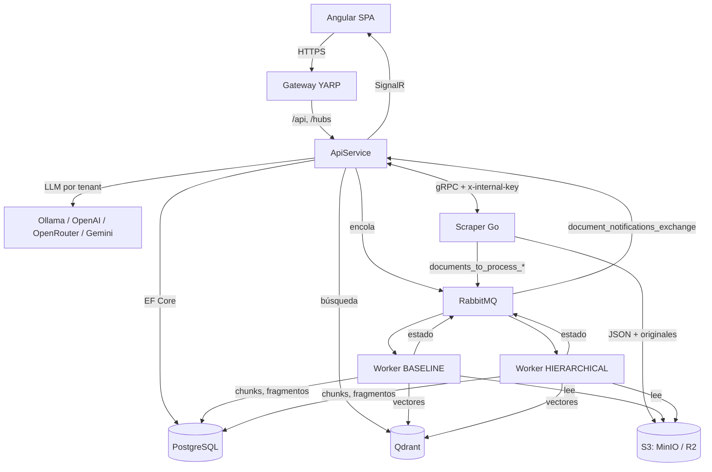

# Arquitectura

**AsistenteAyuntamiento** es un asistente RAG para personal municipal sobre boletines oficiales (BOE, BOJA). En desarrollo lo orquesta **.NET Aspire**; en producción se despliega con Docker Compose (Dokploy).



## Proyectos

| Proyecto | Responsabilidad |
|---|---|
| `AsistenteAyuntamiento.AppHost` | Orquestación Aspire: Postgres (pgvector/pg16), RabbitMQ, Qdrant, MinIO, Ollama, Angular y el scraper Go. |
| `AsistenteAyuntamiento.Gateway` | YARP: sirve la SPA y enruta `/api` y `/hubs` a la API. |
| `AsistenteAyuntamiento.ApiService` | Endpoints minimal API, hubs SignalR (`/hubs/chat`, `/hubs/notifications`) y gRPC. Solo traduce transporte a servicios de Application. |
| `AsistenteAyuntamiento.Worker` | Consumidores de ingesta en modo `BASELINE` o `HIERARCHICAL` (`WORKER_PIPELINE_MODE`). |
| `AsistenteAyuntamiento.Application` | Casos de uso, puertos y orquestación de IA. Sin SDKs de infraestructura. |
| `AsistenteAyuntamiento.Domain` | Entidades y enums. Sin paquetes. |
| `AsistenteAyuntamiento.Infrastructure` | Implementación de los puertos (EF Core, Qdrant, S3, RabbitMQ, Semantic Kernel). |
| `AsistenteAyuntamiento.ServiceDefaults` | OpenTelemetry, health checks y service discovery. |
| `src/AsistenteAyuntamiento.Angular` | SPA (`core/`, `shared/`, `features/`), señales y `OnPush`. |
| `src/go-scraper` | Scraper de BOE y BOJA (`cmd/scraper`). Ver `docs/go-scraper-integration.md`. |

## Capas y puertos (.NET)

`Domain ← Application ← Infrastructure ← hosts (ApiService, Worker)`. `tests/AsistenteAyuntamiento.ArchitectureTests` lo comprueba en CI: Domain no usa paquetes, Application no usa Qdrant, AWS, RabbitMQ, Npgsql ni conectores de proveedor, `IgnoreQueryFilters` solo en ficheros permitidos, y los endpoints no tocan EF Core.

| Puerto (Application) | Implementación (Infrastructure) |
|---|---|
| `IAppDbContext` (+ `ExecuteInTransactionAsync`) | `AppDbContext` (EF Core, Npgsql) |
| `IVectorStore` | `QdrantVectorStore` (colecciones `document_chunks` y `child_fragments`, creadas en la primera escritura) |
| `IBlobStorage` | `S3BlobStorage` (MinIO / Cloudflare R2) |
| `IFullTextSearch` | `PostgresFullTextSearch` (`tsvector` de los fragmentos) |
| `IIngestionMaintenance` | `IngestionMaintenance` (`TRUNCATE` de la ingesta baseline) |
| `IIngestionQueuePublisher` | `RabbitMqIngestionPublisher` (persistente + publisher confirms) |
| `IChatModelFactory` | `ChatModelFactory` (clientes HTTP con nombre, fallback con credenciales propias) |
| `IBackgroundWorkQueue` | `BackgroundWorkQueue` + `BackgroundWorkProcessor` (trabajo en segundo plano con tenant, cancelado al apagar) |

Registro: `AddApplicationServices()` (Application) y `AddInfrastructureServices()` (Infrastructure); los hosts solo añaden lo propio (SignalR, gRPC, consumidores).

## Chat y Arena

`AiChatService` es una fachada sobre:

- `IRagPipeline`: `BaselineRagPipeline` (búsqueda densa en `document_chunks`) y `HierarchicalRagPipeline` (expansión de consulta, búsqueda híbrida RRF densa + texto completo, generación en lenguaje claro).
- `ChatStreamingService`: modelo del tenant con fallback ante cuota (429), errores tipados (`LLM_*`).
- `IAiCallRecorder`: `AiCallLog` y métricas.
- `WinningPipelineSelector`: la pipeline con más victorias en Arena responde (agregado en SQL, caché de 5 min).
- `ShadowTestScheduler`: una muestra de respuestas ejecuta también la otra pipeline en segundo plano y guarda la batalla.
- `ArenaStreamingService`: ambas pipelines en paralelo, reenviadas según llegan.

Los prompts están en `Common/Prompts/PromptCatalog`.

## Multi-tenancy y seguridad

- Tenant = organización de Auth0 (`org_id`). Sin tenant, la API responde 403 fuera de Development.
- Filtros de consulta de EF por tenant; los documentos y vectores de boletines son globales.
- Endpoints de administración con `Policies.Admin` (rol `administrador`); los guards de Angular son solo UX.
- Claves de IA por tenant cifradas con Data Protection y de solo escritura.
- gRPC API ↔ scraper autenticado con `x-internal-key` en ambos sentidos.
- Errores al cliente con códigos estables, sin detalles de excepción.

## Mensajería

Contrato completo en `docs/messaging-contract.md`:

- Colas de trabajo `documents_to_process_baseline` y `documents_to_process_hierarchical`, cada una con `.retry` (30 s) y `.dlq`. Mensajes persistentes, publisher confirms y reintentos acotados en `RabbitMqConsumerBase<T>`.
- Ingesta idempotente: Postgres primero y después se reemplazan los vectores del documento. Un fallo en Qdrant deja el estado `VectorSyncFailed`.
- Estado de documentos: `document_notifications_exchange` (fanout) → API → SignalR (grupo `role:admin`).

## Frontend (Angular)

```
src/app/
  core/      auth (AuthFacade, guards, AUTH_RUNTIME_CONFIG), realtime (HubConnectionFactory, notificaciones), layout (tema)
  shared/    markdown (servicio + pipe), ui (toasts, diálogo de confirmación, foco), models
  features/  chat, documents, settings, profile, arena, analytics, auth-pages
             cada una con data-access/, models/ y componentes
```

Rutas con `loadComponent`. El chat guarda su estado en `ChatStore` (señales inmutables; el streaming se vuelca una vez por frame).

## Calidad y entrega

- CI (`.github/workflows/ci.yml`):
  - higiene: ficheros > 5 MB;
  - .NET: `dotnet format`, build y tests, incluidos Testcontainers para RabbitMQ y Postgres;
  - Angular: tests y build;
  - Go: `vet`, `gofmt` y tests con `-race`;
  - protos: regeneración sin cambios.
- `main` exige esos cinco checks.
- Deploy (`deploy.yml`): tras CI en verde sobre `main`, construye las imágenes afectadas con tags `sha-<short>` y `latest`, y avisa a Dokploy (entorno `production`, con aprobación).
- Versiones centralizadas en `Directory.Packages.props`. Los warnings de nullable son errores.
