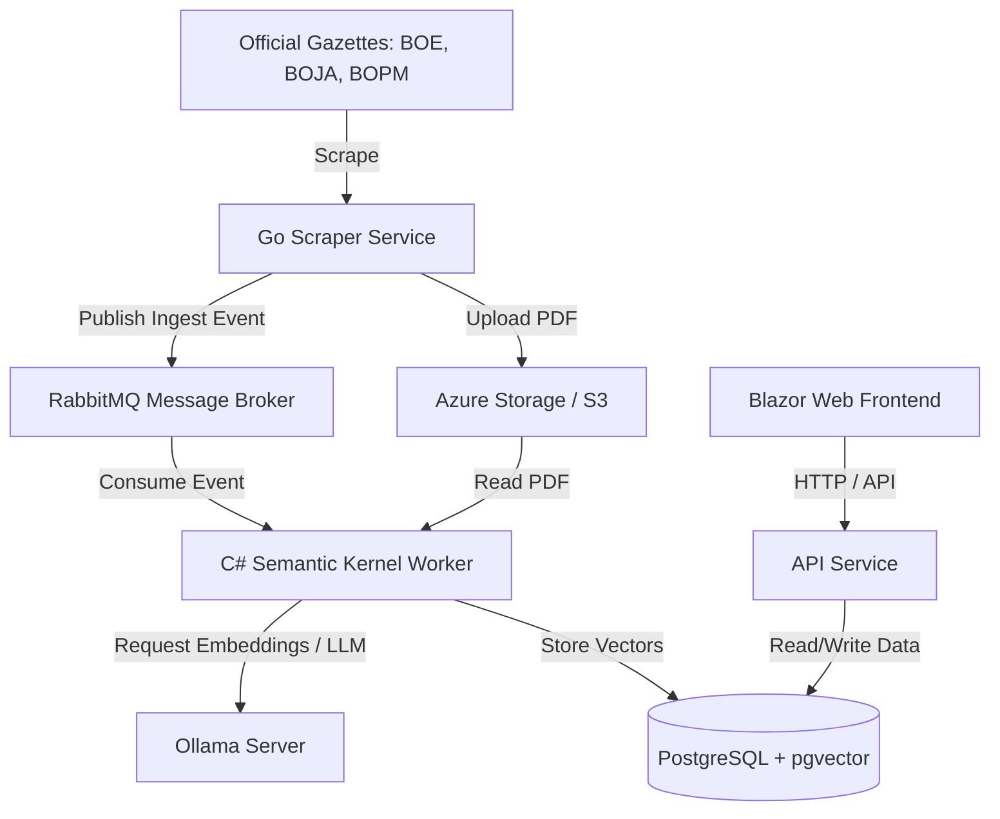

# Go Scraper & Ingestion Integration Design

This document details the architecture, design, and data contracts for integrating the Go-based Scraper service into the DemoTfg RAG system, leveraging Cosmtrek Air for hot-reloading in the .NET Aspire developer environment.

---

## 1. System Architecture Diagram

The Go Scraper runs as an independent worker alongside the .NET core application, orchestrated by .NET Aspire.



---

## 2. Go Scraper Service Overview

The scraper is a single Go binary (`cmd/scraper`, wiring only) built from these packages:

| Package | Role |
|---|---|
| `internal/config` | Loads and validates every environment variable; reports all problems at once. |
| `internal/httpx` | Shared HTTP client: per-site rate limit, timeout, retries with exponential backoff and jitter that stop when the context is cancelled. |
| `internal/provider/{boe,boja}` | Stateless bulletin providers: `FetchSummary(ctx, date, Options)` and `FetchDocument(ctx, ref)`. BOPMA (`internal/bopma`) is a draft and is not registered. |
| `internal/pipeline` | `Orchestrator`: one job at a time (schedule, HTTP and gRPC share the lock), filter rules (fail closed), storage, queueing, metrics and spans. |
| `internal/storage` | S3-compatible bucket with explicit credentials: `json/<source>/<id>.json` and the original as `raw-<ext>/<source>/<id>.<ext>`. |
| `internal/messaging` | Persistent publishing with confirms to both ingestion queues (`docs/messaging-contract.md`). |
| `internal/commandserver` | gRPC `ScraperCommandService.ForceScrape` for the .NET API; requires `x-internal-key`. |
| `internal/httpapi` | `GET /health`, `GET|POST /api/scrape?start=&end=&provider=&section=` (202 + job), `GET /api/jobs/{id}`. |
| `internal/logging` | JSON `slog` with `trace_id`/`span_id` from the active span. |

The daily schedule scrapes the previous day at `SCRAPE_SCHEDULE_HOUR` for `SCRAPE_SCHEDULED_PROVIDERS`. SIGINT/SIGTERM stop the servers gracefully, cancel the running job between documents and flush telemetry.

---

## 3. RabbitMQ Ingestion Event Contract

When the Go Scraper successfully downloads a document from the official gazette and uploads it to the raw storage bucket/container, it publishes an ingestion event to RabbitMQ.

### Queue/Exchange Details
- **Exchange:** `gazette-ingestion-exchange` (Topic or Direct)
- **Routing Key / Queue Name:** `gazette-ingest-queue`

### Message JSON Schema

```json
{
  "eventId": "a5e8c4b9-8e4d-4b8f-8c3d-1a2b3c4d5e6f",
  "source": "BOE",
  "documentId": "BOE-A-2026-12345",
  "title": "Resolución de 12 de julio de 2026, de la Dirección General...",
  "originalUrl": "https://www.boe.es/diario_boe/xml.php?id=BOE-A-2026-12345",
  "storagePath": "raw-documents/boe/2026/07/15/BOE-A-2026-12345.pdf",
  "publishedAt": "2026-07-12T00:00:00Z",
  "scrapedAt": "2026-07-15T14:58:00Z",
  "metadata": {
    "section": "Sección I: Disposiciones generales",
    "department": "Ministerio de Hacienda",
    "contentType": "application/pdf",
    "fileSize": 1048576
  }
}
```

#### Fields Description
| Field | Type | Description |
| :--- | :--- | :--- |
| `eventId` | `string` | Unique identifier (UUID v4) for tracing this ingestion attempt. |
| `source` | `string` | The publication source: `BOE`, `BOJA`, or `BOPM`. |
| `documentId` | `string` | Unique identifier assigned by the official publisher. |
| `title` | `string` | Headline or brief summary title of the resolution/document. |
| `originalUrl` | `string` | Direct link to the source website for tracing back or rendering. |
| `storagePath` | `string` | Relative path or key within the S3/Azure Blob Storage container. |
| `publishedAt` | `string` | Date/time when the gazette was officially published (ISO 8601). |
| `scrapedAt` | `string` | Date/time when the Go worker processed the file (ISO 8601). |
| `metadata` | `object` | Key-value pairs for extendable filtering (department, size, etc.). |

---

## 4. Aspire Integration & Environment Configuration

Aspire runs the module with `AddGoApp("go-scraper", "../go-scraper", "./cmd/scraper")`; Docker builds the same package (`src/go-scraper/Dockerfile`). For hot reload outside Aspire, `air` uses `.air.toml` (sends SIGINT so shutdown runs).

### Environment variables

| Variable | Required | Default | Meaning |
|---|---|---|---|
| `Blob__Endpoint`, `Blob__AccessKeyId`, `Blob__SecretAccessKey` | yes | | S3-compatible bucket (MinIO, Cloudflare R2). |
| `Blob__BucketName` | no | `boletines` | Bucket name. |
| `ConnectionStrings__messaging` | no | | RabbitMQ; without it documents are stored but not queued. |
| `DOTNET_API_GRPC_URL` | no | `http://localhost:5001` | .NET API gRPC endpoint for the filter rules (`https://` uses TLS). |
| `INTERNAL_GRPC_KEY` | in production | | Shared key for gRPC calls in both directions (`Internal__GrpcApiKey` in the API). |
| `PORT`, `GRPC_PORT` | no | `8080`, `50051` | HTTP and gRPC ports. |
| `BOJA_FEEDS` | no | sections s51–s55 | Comma-separated Atom feeds; `BojaFeed` filter rules take precedence. |
| `SCRAPE_SCHEDULE_HOUR` | no | `1` | Local hour of the daily run. |
| `SCRAPE_SCHEDULED_PROVIDERS` | no | `BOE` | Providers of the daily run. |
| `SCRAPE_MAX_RANGE_DAYS` | no | `31` | Longest manual range. |
| `LOG_LEVEL` | no | `info` | `debug`, `info`, `warn` or `error`. |
| `OTEL_EXPORTER_OTLP_ENDPOINT` | no | | Enables traces and metrics export. |

Filter rules of type `Section` (BOE) and `BojaFeed` (BOJA) configure what is fetched; `Keyword` and `Department` rules filter documents. Sections passed in a request override the `Section` rules.
