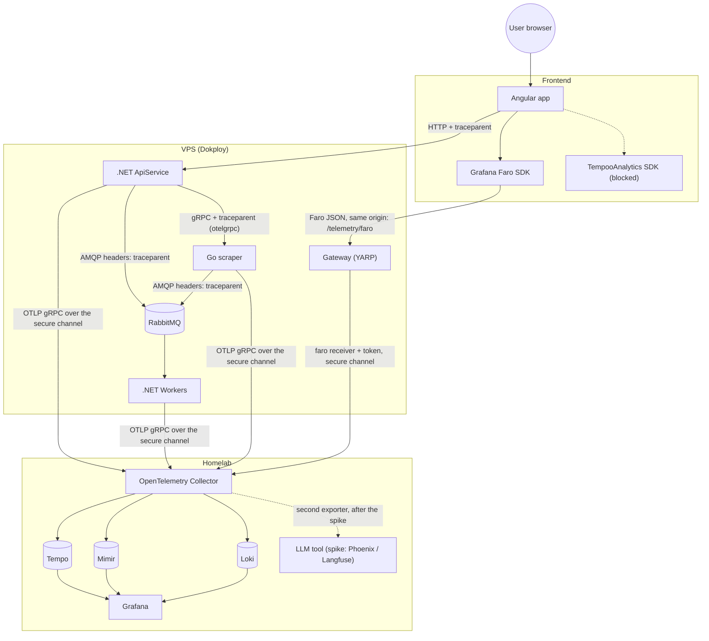

# Observability & Analytics Architecture

How the services send traces, metrics and logs to the self-hosted Grafana stack in the homelab, and what is measured for the LLM calls. Change: `openspec/changes/observability-grafana-tempooanalytics`.



## What is instrumented

| Service | Traces | Metrics | Logs |
|---|---|---|---|
| ApiService, Workers, Gateway (`ServiceDefaults`) | ASP.NET Core, HttpClient, gRPC client, EF Core/Npgsql and RabbitMQ (Aspire), `AsistenteAyuntamiento.*` sources, Semantic Kernel | ASP.NET Core, HttpClient, runtime, `AsistenteAyuntamiento.*` meters, Semantic Kernel | `ILogger` through OpenTelemetry |
| Go scraper (`internal/telemetry`) | Job and document spans, HTTP, gRPC server and client (`otelgrpc`) | Saved, filtered and failed documents | `slog` JSON with `trace_id` / `span_id` |

Nothing is exported unless `OTEL_EXPORTER_OTLP_ENDPOINT` is set. In development, Aspire sets it to its dashboard.

### Trace propagation

- **HTTP and gRPC:** W3C `traceparent` by the standard instrumentation. The .NET gRPC client is instrumented; the Go server continues the trace with `otelgrpc`, and a manual scrape (`ForceScrape`) runs under the request context.
- **RabbitMQ:** publishers add `traceparent` / `tracestate` to the AMQP headers:
  - .NET: `RabbitMqTraceContext.Inject`;
  - Go: `messaging.TraceHeaders`.

  `RabbitMqConsumerBase` starts a `{queue} process` consumer span as a child of that context, so one ingestion request is a single trace from the API (or the scraper job) to the Worker. Retries keep the trace.
- Covered by `RabbitMqConsumerIntegrationTests` (a .NET publisher, and a header written the way Go writes it) and `rabbitmq_test.go`.

## LLM telemetry

Every chat model call, whether in the baseline, hierarchical, Arena or shadow path, records these metrics:

| Metric | Type | Unit | Notes |
|---|---|---|---|
| `gen_ai.client.operation.duration` | histogram | s | `error.type` on failures (typed code such as `LLM_QUOTA_EXCEEDED`) |
| `gen_ai.client.inference.usage.input_tokens` | counter | `{token}` | with `gen_ai.token.modality=text` |
| `gen_ai.client.inference.usage.output_tokens` | counter | `{token}` | |
| `app.llm.time_to_first_token` | histogram | s | streamed calls, measured in the API |
| `app.llm.cost` | counter | EUR | from the `Ai:Pricing` table |

- **Attributes:**
  - GenAI conventions: `gen_ai.operation.name=chat`, `gen_ai.provider.name` (`openai`, `gcp.gemini`, `openrouter`, `ollama`) and `gen_ai.request.model`.
  - Ours: `app.tenant_id`, `app.pipeline` (`baseline`, `hierarchical`, `arena_alfa`, `arena_beta`, `shadow`) and `app.fallback`.
  - User and session ids are never metric labels.
- **Naming:** the names follow `open-telemetry/semantic-conventions-genai` as of October 2026; they are kept in `GenAiTelemetry`. That spec has no client time-to-first-token metric yet, hence `app.llm.time_to_first_token`.
- **Legacy `ai.*` metrics:** the old metrics (`ai.calls.*`, `ai.tokens.*`, `ai.call.duration`) and the `/api/ai/metrics` snapshot remain for one release.
- **Semantic Kernel spans:** `ServiceDefaults` enables Semantic Kernel's GenAI diagnostics **without content** (`Microsoft.SemanticKernel.Experimental.GenAI.EnableOTelDiagnostics`). The sensitive variant is forbidden: `TelemetryPrivacyTests` fails if it appears in settings, compose files or code.
- **Arena:** each `ArenaBattle` stores the `TraceId` of its request, so a vote can be traced to the spans of both answers.

### Prices

`Ai:Pricing:{provider}:{model}:{Input,Output}` holds the price in EUR per million tokens.

- **Compose:** `docker-compose.yml` passes the price of the platform chat model from `AI_CHAT_PRICE_INPUT_EUR` / `AI_CHAT_PRICE_OUTPUT_EUR`. Models chosen by tenants are added to the `apiservice` environment in the same way, for example `Ai__Pricing__openai__gpt-4o-mini__Input=0.14`.
- **Models without a price:** Ollama costs 0. Any other model without a price records 0 and logs one warning.
- **Model ids with `:`:** these (Ollama tags) cannot be configuration keys. They are self-hosted, so this does not matter.

### Dashboard

Import `docs/grafana/llm-dashboard.json` in Grafana and choose the Mimir/Prometheus data source. It shows:
- cost per tenant and model;
- tokens per pipeline;
- p50/p95 latency and time to first token;
- fallback rate;
- errors by code.

The queries use the Prometheus names produced by the OTLP translation: dots become underscores, and `_seconds` / `_total` suffixes are added. For example, `gen_ai_client_operation_duration_seconds_bucket` and `app_llm_cost_total`.

## Production configuration

Variables per container (`docker-compose.yml`, values in `.env`):

```env
OTEL_EXPORTER_OTLP_ENDPOINT=https://otel.homelab.example:4317   # empty = no export
OTEL_EXPORTER_OTLP_HEADERS=Authorization=Bearer <token>
OTEL_SERVICE_NAME=apiservice                                     # set per service in the compose file
OTEL_RESOURCE_ATTRIBUTES=deployment.environment.name=production,deployment.environment=production
```

`deployment.environment.name` is the current semantic convention. `deployment.environment` is kept for dashboards that still use it.

### Secure channel VPS → homelab

The Collector must not be open to the internet. Recommended setup:
1. **Private network.** A WireGuard (or Tailscale) tunnel between the VPS and the homelab. The Collector listens only on the tunnel address.
2. **TLS and a token.** The Collector receivers use TLS and the `bearertokenauth` extension. The services send the token in `OTEL_EXPORTER_OTLP_HEADERS`.
3. **Faro.** The browser cannot use the tunnel, so it never talks to the Collector. It posts to `/telemetry/faro` on the app's own origin, and the gateway forwards to the Collector's `faro` receiver over the tunnel. The gateway adds the token, removes cookies and `Authorization`, caps the size at 256 KB and rate-limits (120/min per client IP, 6000/min in total).

### Collector configuration (homelab)

```yaml
extensions:
  bearertokenauth:
    token: ${env:OTLP_TOKEN}
  health_check: {}

receivers:
  faro:                              # browser data, forwarded by the gateway
    endpoint: ${env:TUNNEL_IP}:4319
    tls: { cert_file: /certs/collector.crt, key_file: /certs/collector.key }
    auth: { authenticator: bearertokenauth }
  otlp:
    protocols:
      grpc:
        endpoint: ${env:TUNNEL_IP}:4317
        tls: { cert_file: /certs/collector.crt, key_file: /certs/collector.key }
        auth: { authenticator: bearertokenauth }
      http:
        endpoint: ${env:TUNNEL_IP}:4318
        tls: { cert_file: /certs/collector.crt, key_file: /certs/collector.key }
        auth: { authenticator: bearertokenauth }

processors:
  memory_limiter: { check_interval: 1s, limit_percentage: 80, spike_limit_percentage: 20 }
  batch: {}
  # Defence in depth: drop any prompt/completion attribute that might slip through.
  attributes/drop-content:
    actions:
      - { key: gen_ai.prompt, action: delete }
      - { key: gen_ai.completion, action: delete }
      - { key: gen_ai.input.messages, action: delete }
      - { key: gen_ai.output.messages, action: delete }

exporters:
  otlp/tempo:
    endpoint: tempo:4317
    tls: { insecure: true }          # inside the homelab network
  otlphttp/mimir:
    endpoint: http://mimir:9009/otlp
  otlphttp/loki:
    endpoint: http://loki:3100/otlp
  # Second exporter for the LLM tool, enabled only after the spike (tasks 6.x):
  # otlp/llm-tool:
  #   endpoint: phoenix:4317
  #   tls: { insecure: true }

service:
  extensions: [bearertokenauth, health_check]
  pipelines:
    traces:
      receivers: [otlp, faro]
      processors: [memory_limiter, attributes/drop-content, batch]
      exporters: [otlp/tempo]        # add otlp/llm-tool here after the spike
    metrics:
      receivers: [otlp]
      processors: [memory_limiter, batch]
      exporters: [otlphttp/mimir]
    logs:
      receivers: [otlp, faro]
      processors: [memory_limiter, batch]
      exporters: [otlphttp/loki]
```

Use the `otelcol-contrib` distribution (`bearertokenauth` is not in the core one). Mimir must accept OTLP (`/otlp`). Keep its default translation strategy (underscores with unit suffixes) so the dashboard queries match.

## Frontend: Grafana Faro

`core/telemetry` (Angular):
- **Startup:** `FaroTelemetry` asks the gateway for `/telemetry/config` after the app has started. If a Collector is configured, it loads `@grafana/faro-web-sdk` and `@grafana/faro-web-tracing` with a dynamic `import()`. Faro (about 76 kB transferred) stays out of the initial bundle, and nothing is loaded when it is disabled.
- **What it sends:** sessions, views (named by route template, such as `/admin/analytics`, never with ids), Web Vitals, and errors from Angular's `ErrorHandler` (`FaroErrorHandler`). The window errors arrive there too through `provideBrowserGlobalErrorListeners`, so Faro's own error and console instrumentations are off to avoid duplicates.
- **Browser → API traces:** `traceparent` is propagated only to `/api/` and `/hubs/` of the API origin (`propagateTraceHeaderCorsUrls`). Faro's own sends, SignalR negotiation and Auth0 are not traced. Unsampled sessions send no trace context (`omitTraceContextForUnsampledSessions`), so they do not suppress backend traces.
- **Privacy:** every item goes through `scrub` before leaving the browser. It removes the query string and fragment from page URLs, because the Auth0 callback carries `code` and `state`. No console capture, user data or geolocation.

Gateway settings (`Telemetry:Faro`, from `.env`): `FARO_COLLECTOR_URL` (empty = disabled), `FARO_COLLECTOR_TOKEN` and `FARO_SAMPLE_RATE` (0–1).

Checked locally against a fake gateway: session, view, a single error and the `traceparent` on `/api` arrive, the `?code=` never leaves the browser, and Faro does not trace its own sends. The full browser → API → Worker trace in Tempo is checked once the Collector is installed.

## TempooAnalytics (blocked)

Tasks 4.x–5.x are blocked until its SDK or API exists. Planned variables: `TEMPOOANALYTICS_API_URL` and `TEMPOOANALYTICS_API_KEY`.
